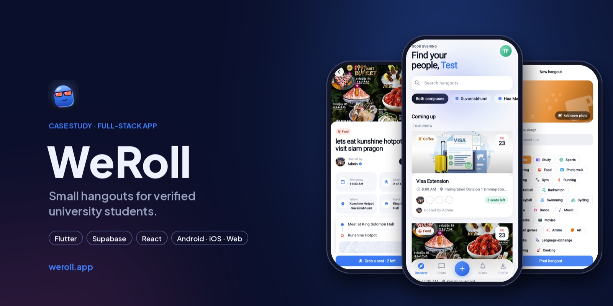
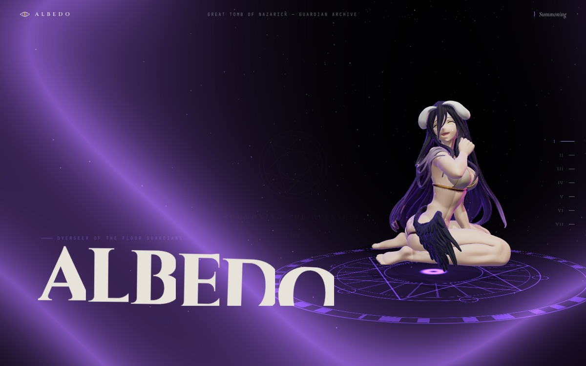
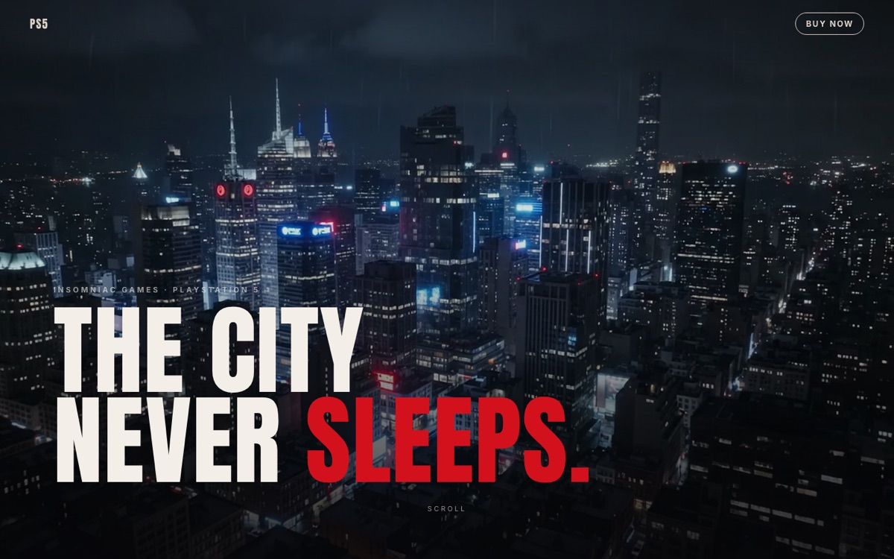
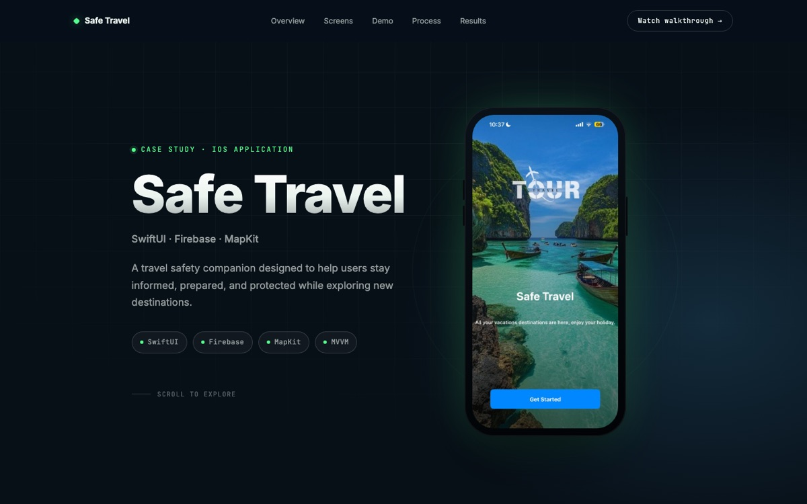
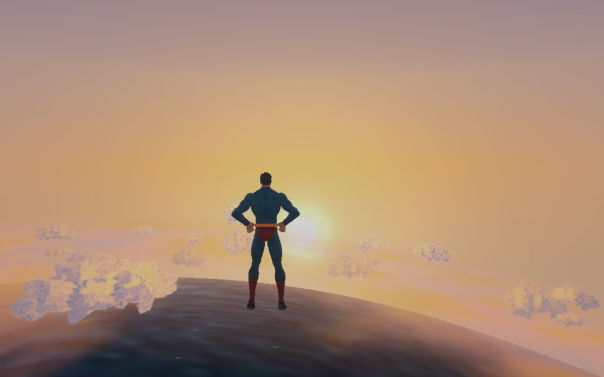

<a href="https://adrein.dev">
  
</a>

<p align="center">
  <a href="https://adrein.dev"></a>
  <a href="mailto:adrein.dev@gmail.com"></a>
  <a href="https://www.tiktok.com/@chillin_drax"></a>
</p>

<br>

### `01 / about`

> **Not just pixels. Not just code.**
> I create digital products with a designer’s eye and a developer’s execution — interfaces that are clear, smooth, useful, and impossible to ignore.

```ts
const adrein = {
  role:      ["UI/UX Designer", "Full-Stack Developer", "AI Automation Builder"],
  based:     "Bangkok, Thailand",
  studying:  "Information Technology @ Assumption University",
  process:   "Design → Build → Deliver",
  learning:  ["Three.js", "advanced automation", "scalable systems"],
  openTo:    ["freelance", "collaborations", "creative tech ideas"],
};
```

<br>

### `02 / stack`

<p>
  <br>
  
</p>

| `01` Design | `02` Frontend | `03` Backend |
| :-- | :-- | :-- |
| UX research, interface design, prototyping in Figma | React, Tailwind, responsive layouts, interactive experiences | Node.js, APIs, auth, databases, dashboards, deployment |
| **`04` Motion** | **`05` Automation** | **`06` Product** |
| Scroll reveals, micro-interactions, cinematic transitions | AI workflows, n8n, Google Sheets systems, bots, lead capture | User flows, problem solving, client communication |

<br>

### `03 / selected work`

<table>
  <tr>
    <td colspan="2" valign="top">
      <a href="https://weroll.app"></a>
      <br><b><a href="https://weroll.app">WeRoll — Small Hangouts for University Students ↗</a></b>
      <br><sub><code>Flutter</code> <code>Supabase</code> <code>React</code> <code>Android</code> <code>iOS</code> <code>Web</code></sub>
      <br><sub>A full-stack app for verified university students: find or host coffee, study and game meetups, then chat, voice-call and check in with your group. Live on web, Android in Google Play testing.</sub>
    </td>
  </tr>
  <tr>
    <td width="50%" valign="top">
      <a href="https://albedofigure.onrender.com/"></a>
      <br><b><a href="https://albedofigure.onrender.com/">Albedo Guardian Archive ↗</a></b>
      <br><sub><code>3D</code> <code>Three.js</code> <code>Motion</code></sub>
      <br><sub>An interactive fan archive with a real-time 3D figure, a glowing summoning circle and dark-fantasy type.</sub>
    </td>
    <td width="50%" valign="top">
      <a href="https://spidy-53wm.onrender.com/"></a>
      <br><b><a href="https://spidy-53wm.onrender.com/">Spider-Man 2 Landing Page ↗</a></b>
      <br><sub><code>Web Design</code> <code>Motion</code> <code>Frontend</code></sub>
      <br><sub>A cinematic PS5 game page: moody night-city hero, bold editorial type, scroll-driven storytelling.</sub>
    </td>
  </tr>
  <tr>
    <td width="50%" valign="top">
      <a href="https://safetravel-fy2y.onrender.com/"></a>
      <br><b><a href="https://safetravel-fy2y.onrender.com/">Safe Travel ↗</a></b>
      <br><sub><code>iOS</code> <code>SwiftUI</code> <code>Firebase</code> <code>MapKit</code></sub>
      <br><sub>A travel safety companion that keeps people informed, prepared and protected while exploring.</sub>
    </td>
    <td width="50%" valign="top">
      <a href="https://github.com/xandra-X/skyfall-hero"></a>
      <br><b><a href="https://github.com/xandra-X/skyfall-hero">Skyfall Hero — Superhero Game ↗</a></b>
      <br><sub><code>Unity 6</code> <code>C#</code> <code>3D</code> <code>iOS</code></sub>
      <br><sub>Fly, smash and laser through a living city, then soar through the clouds into space and onto the Moon.</sub>
    </td>
  </tr>
</table>

<p align="center"><a href="https://adrein.dev/#projects"><b>See every project on adrein.dev →</b></a></p>

<br>

### `04 / services`

<table>
  <tr>
    <td>🎨 UI/UX Design</td>
    <td>🌐 Websites & Landing Pages</td>
    <td>🧱 Full-Stack Web Apps</td>
  </tr>
  <tr>
    <td>📱 iOS & Android Apps</td>
    <td>🤖 AI Chatbots</td>
    <td>💬 Messenger & Telegram Bots</td>
  </tr>
  <tr>
    <td>⚙️ Business Workflow Automation</td>
    <td>📊 Dashboards</td>
    <td>📣 Social Media Automation</td>
  </tr>
</table>

<br>

<a href="mailto:adrein.dev@gmail.com">
  
</a>
